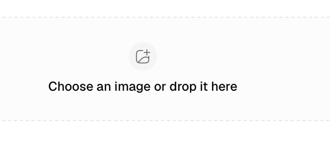

## In the body

Put the cursor where you want the image, then do one of these:

- **Paste** an image you have copied.
- **Drop** an image file into the editor.
- **Upload** one with the editor's image button.

orso saves the file in your project and adds it to the body. For more on editing entries, see [Edit blog posts and other collections](../edit-blog-posts-and-collections/).

## In an image field

For fields such as a blog post's cover image, use the field's upload control or drop a file onto it.

## Alt text

Describe every image for people who can't see it. Blog covers have their own alt text field. Say what the image shows and why it matters, not "image of…".

## Tips

- Use images at a sensible size. Very large photos slow your pages down.
- Use clear file names, such as `pricing-table.png` rather than `IMG_2041.png`.

