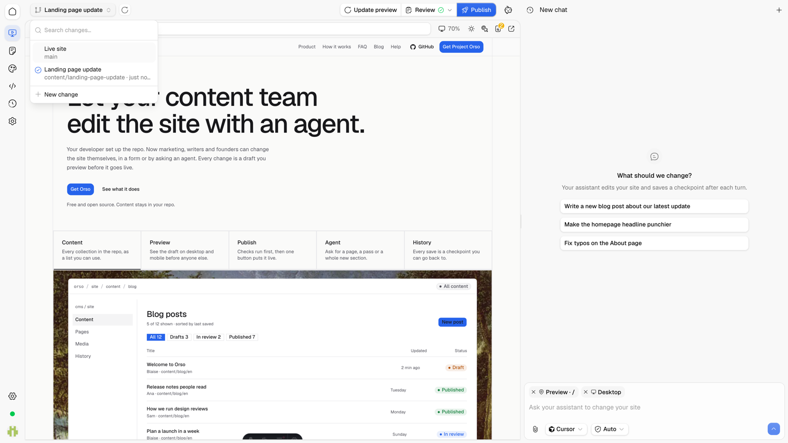

## Start a change

orso never edits your live site directly. The first time you edit something, it asks you to start a change. A change is a Git branch with a readable title. Give it a title that says what you are doing, such as "Rewrite the home page headline".

You can see the current change, switch to another one or start a **New change** from the menu at the top left.

## Make an edit

You can edit in three ways:

- **In the Content tab.** Open a blog post or help article, edit its fields and body, and the preview updates as you type. See [Edit blog posts and other collections](/help/edit-blog-posts-and-collections/).
- **With the assistant.** Describe what you want, such as "make the hero headline shorter and friendlier", and the agent edits the files for you. See [Write good requests](/help/write-good-requests/).
- **In the Code tab.** Edit the files directly if you are comfortable with Astro.

## Check the preview

The **Preview** tab shows your site with your change applied. Click through the pages you touched, and check them in both light and dark mode if your site has both.

## Save your work

orso saves versions of your work as you go. You can see them in the **History** tab and restore an earlier one if you change your mind. See [Use history to restore earlier versions](/help/history-and-restoring/).

## When you are happy

Choose **Share preview** to push the change and open a pull request. See [Share a preview](/help/share-a-preview/) for what happens next.
