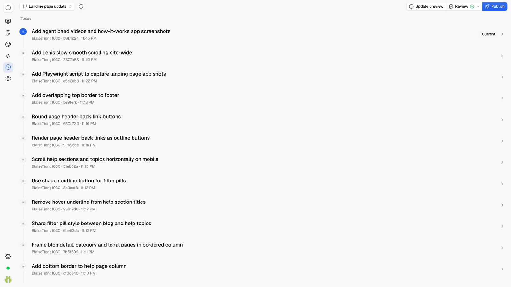
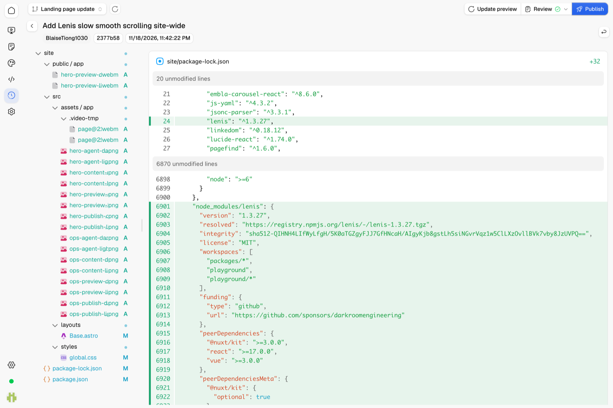

orso saves versions of your work as you edit. The **History** tab lists them, newest first, with who made each one and what it changed.

## See what changed

Choose a version to see the files it changed, and what was added and removed in each.

## Restore a version

1. Find the version you want to go back to.
2. Choose **Restore this version** and confirm.

orso puts your change back to how it was at that point. Versions saved after it, and any edits you haven't saved yet, are discarded, so check you've picked the right one.

## Restore versus undo

Restoring only affects your current change. It doesn't touch the live site or other people's changes. To undo something that is already live, make a new change that reverses it and [publish that](../publish-your-changes/).
