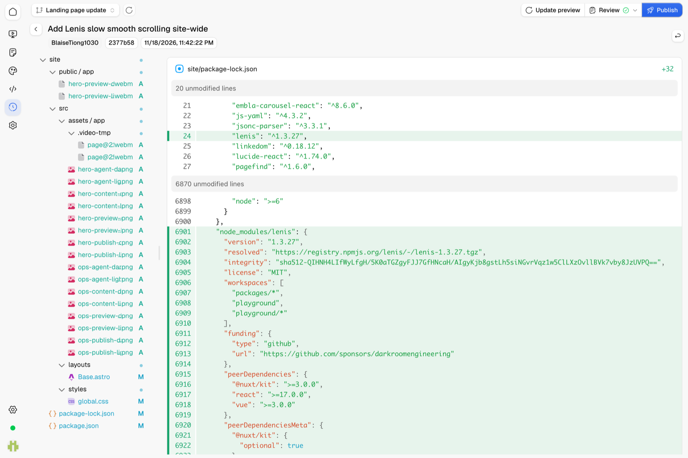

The assistant works on your current change, just like you do. Nothing reaches your live site until you publish, so you always get a chance to check.

## Check the preview

Open the pages the assistant touched in the **Preview** tab. Read the text, click the links and check the layout on a narrow window too.

## See which files changed

The **History** tab ([more about history](/help/history-and-restoring/)) shows each saved version and the files it changed. Open a version to see exactly what was added and removed.

## Undo

- **Ask for a fix.** If something is nearly right, tell the assistant what to change: "the new section is too wide; match the width of the features section".
- **Restore an earlier version.** In **History**, choose a version from before the edit and choose **Restore this version**.

## Before you share

Read the change once from start to finish as a visitor would. When you are happy, choose **Share preview**. See [Share a preview](/help/share-a-preview/).
