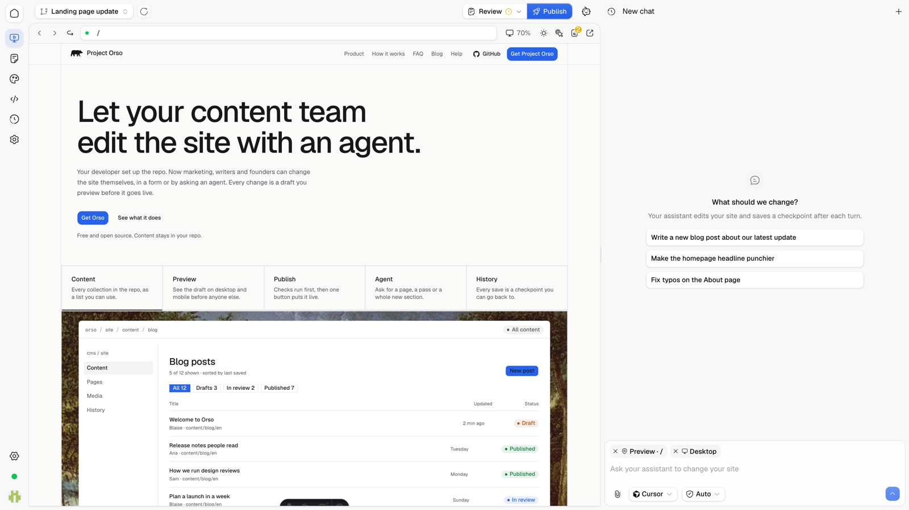
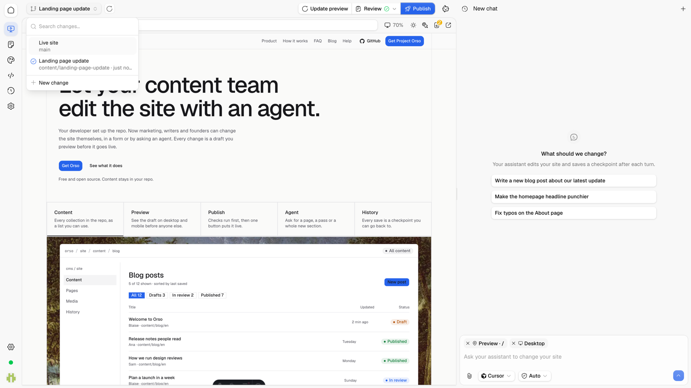

When you open a project, the tabs are in the rail on the left.

## The tabs

- **Preview.** Your site running live, open on the page you are viewing. Click around just as a visitor would. If it doesn't load, see [The preview is blank or broken](/help/preview-not-loading/).
- **Content.** Blog posts, help articles and your other content collections. Each entry has a form for its fields and a rich-text editor for the body. See [Edit blog posts and other collections](/help/edit-blog-posts-and-collections/).
- **Design.** Colours, fonts and other design settings that apply to the whole site. See [Change colours and fonts](/help/change-colours-and-fonts/).
- **Code.** The project's files, for when you want to look under the hood.
- **History.** Saved versions of your work and what changed in each one. You can restore an earlier version from here. See [Use history to restore earlier versions](/help/history-and-restoring/).
- **Settings.** Settings for the project.

## Changes

The current change is shown at the top of the workspace. A change is a Git branch with a readable title, such as "Update pricing page". Choose it to switch between your changes, go back to the live site, or start a new one.

Everything you edit, and everything the assistant edits, goes onto the current change.

To work on something unrelated, start a **New change** so the two pieces of work can be reviewed and published separately.

## The assistant

Open the assistant to describe a change in plain words and let a coding agent make it. See [Choose an assistant](/help/choose-an-assistant/).
